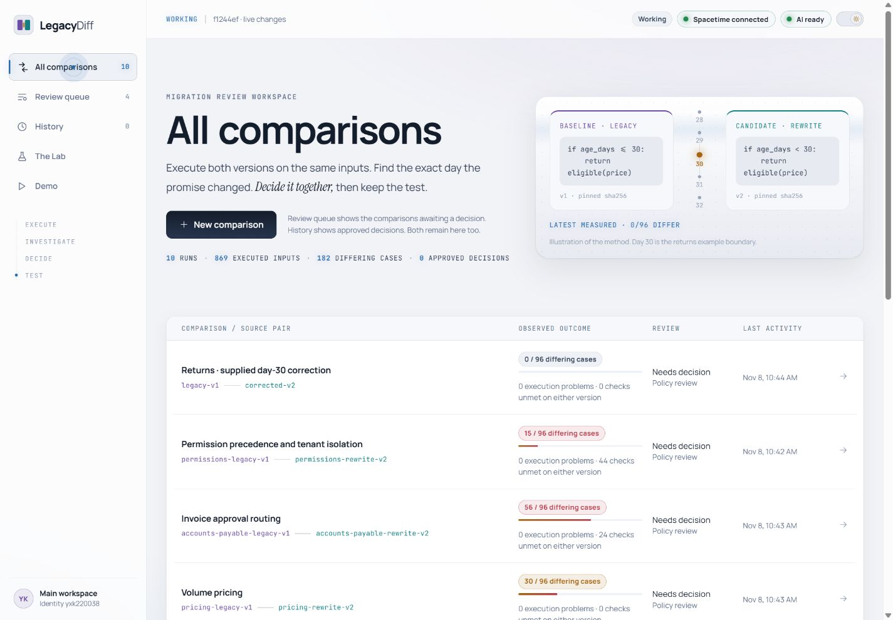
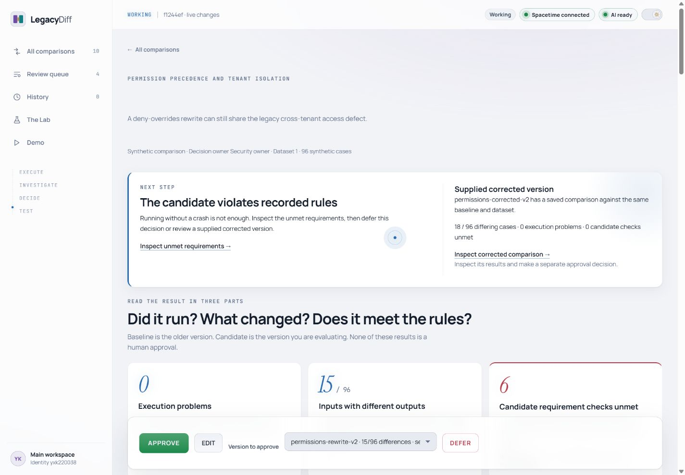
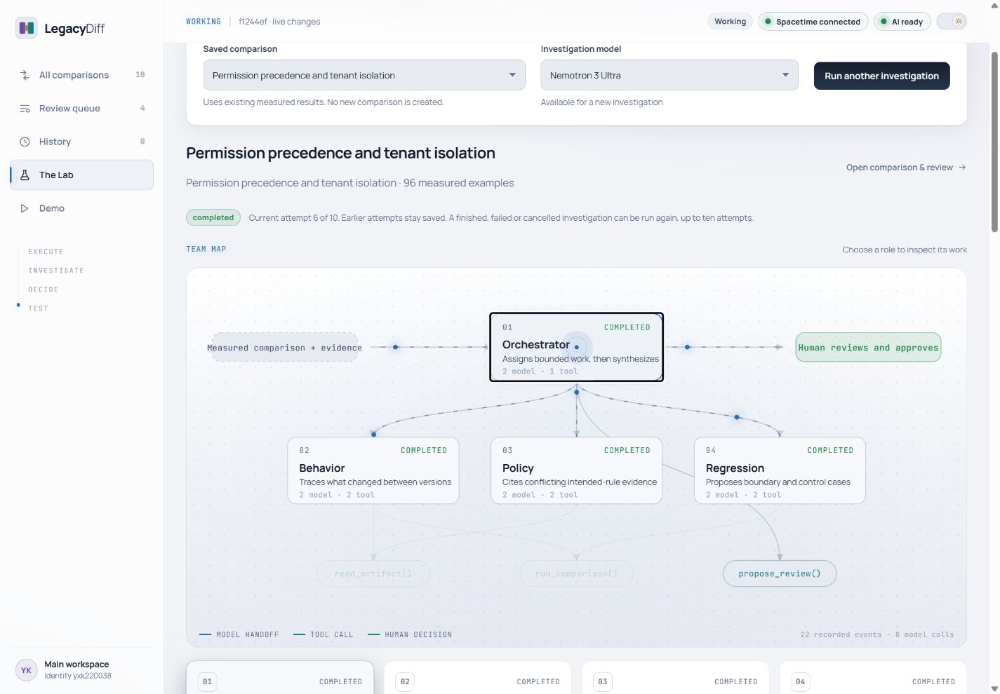
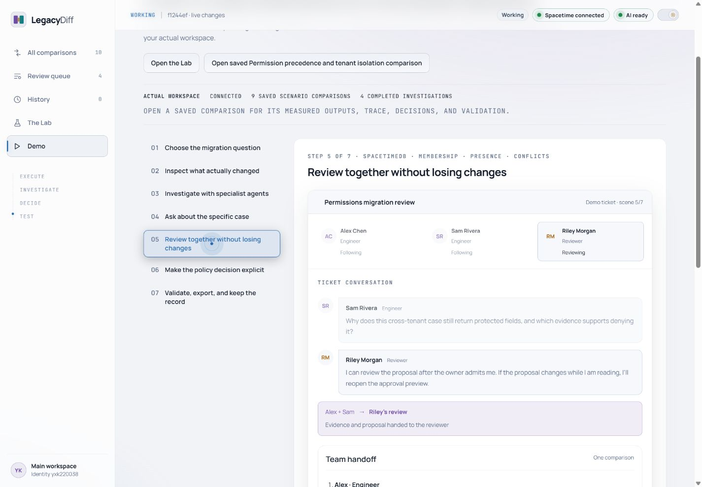

# LegacyDiff

Understand what changed in a rewrite. Decide what the software should do. Keep the tests that support that decision.

LegacyDiff runs old and new implementations on the same inputs, shows their actual outputs, and helps a team review the differences. NVIDIA Nemotron specialists explain the evidence. A human chooses the intended behavior and approves an exact version. Spacetime keeps the shared review in sync.



## Why it exists

A rewrite can copy an old bug or introduce a new one. Matching the old system is useful evidence, but the old system may be wrong.

A return on day 30 might qualify under the handbook and fail under the migration ticket. A discount might apply twice. An invoice might bypass approval because the rewrite checks the amount before tax. Two permission systems can agree while both expose another customer's data.

LegacyDiff keeps three questions separate:

- What did each version actually return?
- What does the approved policy say should happen?
- Which independent requirements must both versions meet?

A crash or timeout is an execution problem. Different outputs need investigation. A failed requirement means the code ran but broke a recorded rule.

## A tour of the app

### Comparisons and review queue

All comparisons shows the saved runs. The review queue shows tickets waiting for a decision. Deferred tickets remain in All comparisons. History contains approved decisions and their validation results.

The current local demo has ten saved comparisons and four awaiting review. These are local records, not data automatically installed in a fresh checkout.

### Evidence and decisions

Open a comparison to inspect the same input in both versions, exact output differences, independent requirements and pinned source evidence. Choose a saved candidate version, edit the intended behavior and rationale, then approve or defer. The final approval confirmation identifies the exact version and expectations.

Changing the candidate does not transfer approval. A later proposal does not overwrite an earlier decision. Security requirements cannot be waived to achieve parity.



### The Lab

An orchestrator coordinates three specialist conversations:

| Role | Question |
| --- | --- |
| Behavior | What changed between the versions? |
| Policy | What does the evidence say should happen? |
| Regression | Which examples should protect that decision? |

The Lab shows recorded model calls, tool activity, handoffs and saved findings. The animated connections illustrate the team structure. Status labels show what actually happened. Case chat lets reviewers ask follow-up questions using the comparison's saved context.

Three model choices appear in the UI. Each becomes available only after the worker verifies its tool round trip. Availability depends on the provider. AI findings remain advice and can contain mistakes.



### Team review and guided demo

Each ticket has a team chat. Server-side membership determines who can read and contribute. An owner admits a new identity and assigns its role. Only reviewers can approve. Stale or competing approvals are rejected.

The Demo page tells the story through Alex, Sam and Riley in seven scenes. Play, pause, replay or move through the steps manually. It covers comparison setup, measured results, specialist investigation, case chat, collaboration, approval and export. The teammates and conversation are staged. Playback does not create real members, comments or approvals. Links open the actual saved comparison and The Lab.



## Four synthetic scenarios

| Scenario | Review question | Authored inputs |
| --- | --- | ---: |
| Returns | Does the return window include day 30? | 96 |
| Pricing | Does the unit price already include the discount? | 96 |
| Accounts payable | Does the approval threshold use net or gross? | 96 |
| Permissions | Do deny rules and tenant boundaries hold? | 96 |

There are 384 distinct authored inputs. Multiple comparisons can reuse them with different source pairs. Results come from executing the reviewed fixtures. Supplied corrected candidates are separate versions, not automatic AI repairs. See [the fixture contracts](fixtures/SUITES.md).

## Run locally on Windows

You need Python 3.11 or later, npm and Node. The project pins Node 24.22.1 and Spacetime CLI, server and SDK 2.14.1. Setup downloads the pinned Spacetime tools and checks the archive hash.

```powershell
powershell -File scripts/setup-local.ps1
```

Start the services in separate terminals:

```powershell
# Terminal 1: local database
powershell -File scripts/start-database.ps1

# Terminal 2: publish the local module, then start the worker
powershell -File scripts/publish-local.ps1
npm run worker

# Terminal 3: frontend
npm run dev
```

Open [LegacyDiff locally](http://127.0.0.1:5174). Choose New comparison, select a scenario and source pair, then compare without AI or use an available model. No paid service or API key is needed for deterministic comparison.

For AI, copy `.env.example` to `.env`, set `NVIDIA_API_KEY` in that ignored file and restart the worker. Never put the key in a `VITE_` variable or browser storage. Worker health is available at [localhost:3001/health](http://127.0.0.1:3001/health).

Keep `.local/` private. It holds local data and identities. Preserve it across restarts. Do not delete database data to resolve a migration conflict.

### Main and Working previews

For an existing registered preview checkout, run `npm run browse`. Main and Working share one saved workspace and backend. Main shows merged frontend code. Working shows current edits.

- Working opens at `http://127.0.0.1:5174/`.
- Main opens at `http://127.0.0.1:5174/main/`.
- `npm run browse:refresh` updates the clean Main preview after a merge.
- `npm run browse:stop` stops launcher-owned processes without deleting data.

See [local preview setup](docs/LOCAL_PREVIEWS.md) for worktree registration. These links are local, so remote teammates cannot join through them.

## Validate and export a decision

1. Open a comparison and inspect its outputs and independent requirements.
2. Select the version you want to review.
3. Use EDIT to choose intended behavior, supporting evidence and a rationale.
4. Choose APPROVE and confirm the exact expectations, or DEFER to leave the decision open.
5. Inspect the actual acceptance results. Approval does not guarantee a passing candidate.
6. Download the review bundle after validation and run its checks outside the UI.

```powershell
python -I acceptance_tests.py
```

A failing acceptance check is a meaningful result. For example, approving an inclusive day-30 rule against the exclusive rewrite should fail. Review the supplied corrected version separately.

## Developer map

| Folder | Owns |
| --- | --- |
| `frontend/` | React screens, styles, motion and local drafts |
| `packages/client/` | Identity, authorized subscriptions and typed actions |
| `packages/contracts/` | Shared data shapes and validation schemas |
| `backend/database/` | Membership, approvals, receipts and job rules |
| `backend/worker/` | Trusted job execution and authenticated exports |
| `backend/ai/` | Nemotron orchestration and evidence tools |
| `backend/runner/` | Python execution, comparison and acceptance checks |
| `fixtures/` | Reviewed synthetic source files, inputs and policies |
| `tests/` | Behavior, database, browser and export checks |
| `docs/` | Requirements, architecture and verification evidence |

Start with the [frontend guide](frontend/README.md), [backend guide](backend/README.md), [shared contracts](packages/README.md) and [architecture](docs/ARCHITECTURE.md). Frontend contributors can replace the UI while keeping authorization and execution in the backend. `AGENTS.md` contains the shared contributor instructions.

## Checks

```powershell
npm run typecheck
npm run lint
npm run format:check
npm test
npm run test:python
npm run build
```

Database integration tests require an isolated server on port 3012 with the current module published. They change the test provider catalog and must not run against your demo database. Do not run an automatic worker against that isolated server during these tests.

```powershell
$env:LEGACYDIFF_DB_PORT='3012'
$env:LEGACYDIFF_WORKER_PORT='3013'
$env:LEGACYDIFF_WEB_PORT='5176'
npm run test:integration
# Optional real lease-expiry check takes about a minute
$env:LEGACYDIFF_LEASE_TEST='1'
npm run test:integration
```

Use a separate terminal for these environment overrides. The test files run sequentially because they share the isolated catalog. The browser suite is `npm run test:e2e` and needs the running local services and Playwright runtime. It creates test records, so use a disposable test workspace.

GitHub Actions checks types, lint, formatting, core tests, Python tests and the frontend build. Live database, browser and NVIDIA checks are separate. See [verification evidence](docs/VERIFICATION.md) for actual results and limitations.

## Current boundaries

- Execution accepts only reviewed, allowlisted and hash-verified bundled fixtures.
- The local runner is a trusted-fixture fallback with reduced isolation. It is not an arbitrary-code sandbox.
- The app is local. Public hosting, production data and arbitrary repository ingestion are outside this build.
- AI suggestions do not approve policies, repair code or establish production readiness.
- Differential testing does not establish complete security. Matching versions can share a defect.
- Broader security testing, dependency analysis, stateful retries and concurrency inside migrated programs are separate capabilities.

Screenshots show synthetic local records. They illustrate the interface and do not replace the recorded test evidence.
